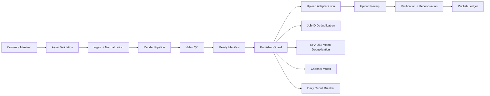

# AI Content Automation Engine

A self-hosted, reliability-first content production and publishing architecture for AI-assisted short-form video workflows.

This project packages the core engineering patterns behind a production-oriented YouTube automation system: asset validation, media quality control, manifest-driven rendering, duplicate prevention, idempotent publishing, upload state tracking, and reconciliation.

> **Portfolio snapshot:** secrets, OAuth credentials, channel identifiers, runtime state, production webhooks, and private workflow exports are intentionally excluded.

## Why this project exists

Content automation becomes fragile when generation, rendering, scheduling, and publishing are treated as one long best-effort workflow. A timeout or retry can create duplicate uploads, inconsistent state, or partially published content.

This architecture separates those responsibilities and makes publishing **stateful, idempotent, and fail-closed**.

## Architecture



## Core reliability guarantees

### Duplicate prevention

Before an upload can begin, the publisher checks:

- durable `job_id` history
- SHA-256 hash of the rendered video
- existing upload receipts
- in-flight claims
- a channel-level upload mutex
- the configured daily upload limit

A repeated workflow execution therefore does not automatically become a repeated YouTube upload.

### Idempotent state transitions

Publishing is split into explicit states such as:

`CLAIMED → UPLOAD_STARTED → UPLOADED → VERIFIED / SCHEDULED / PUBLISHED`

Claims, receipts, and the publish ledger are written atomically so a retry can inspect durable state before deciding what to do next.

### Fail-closed publishing

The system blocks publishing when important invariants are not satisfied, including:

- publishing disabled in configuration
- QC has not passed
- missing manifest fields or rendered video
- duplicate job or content hash
- another channel upload already in flight
- daily upload circuit breaker reached
- a previous upload may have started but has not yet been reconciled

### Reconciliation

A separate reconciliation loop verifies already-uploaded videos and handles compliance / verification retries without blindly submitting the video again.

## Pipeline components

### `pipeline/`

Media and manifest validation utilities used before publishing:

- asset quality gates
- image ingestion and normalization
- AI image worker boundary
- manifest validation
- video QC
- selective repair support
- preparation of publish-ready manifests

### `publisher/`

Durable publishing state machine:

- `publisher_guard.js` — pre-upload decision gate
- `state.js` — atomic state, claims, receipts, hashes, events
- `mark_uploading.js` — records the point after which blind retry is unsafe
- `record_upload.js` — stores durable upload receipt and content hash
- `record_verified.js` — records verification / scheduling / publication state

### `orchestrator/`

Operational loops that coordinate the publisher and verifier while keeping public-facing upload logic behind an internal integration boundary.

## Test coverage

The included idempotency test exercises the most important publishing guarantees:

- first job is accepted
- second concurrent job is blocked by the channel mutex
- an in-flight job cannot be submitted twice
- upload receipt is durable
- identical video content is blocked by SHA-256 hash
- daily upload limit blocks additional publishing
- reused job IDs are blocked
- global publishing pause is respected

Run it with:

```bash
python3 tests/test_idempotency.py
```

## Example configuration

Copy the safe examples and keep credentials outside Git:

```bash
cp .env.example .env
mkdir -p runtime/youtube
cp config/config.example.json runtime/youtube/config.json
```

Production webhook URLs are designed to remain loopback-only (`127.0.0.1`) so the internal publisher interface is not directly exposed to the internet.

## Security

This repository does **not** contain:

- Google / YouTube OAuth credentials
- access or refresh tokens
- OpenAI API keys
- channel IDs
- production webhook credentials
- server IP addresses
- runtime state or upload receipts
- generated media or private workflow exports

The repository demonstrates architecture and reliability patterns; it is not a drop-in hosted publishing service.

## Stack

`Python` · `Node.js` · `FFmpeg` · `n8n` · `YouTube Data API` · `OAuth` · `Docker` · `Linux` · `OpenAI image generation`

## Engineering focus

This project is part of my AI Automation / Systems Architecture portfolio and focuses on one specific problem: **making autonomous publishing safe enough to retry without creating duplicate or inconsistent external side effects.**

---

**Built by Emircan Dokumacı**  
GitHub: https://github.com/emircandokumaci
